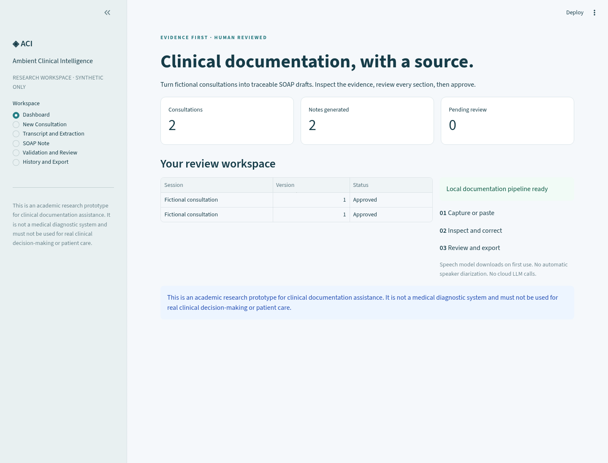

# ACI — Ambient Clinical Intelligence

A working, local-first **fictional consultation** documentation prototype: audio/text → evidence-linked facts → SOAP draft → review → approved export.

> This is an academic research prototype for clinical documentation assistance. It is not a medical diagnostic system and must not be used for real clinical decision-making or patient care.



## Run on Windows 10/11

Install Python 3.12 and Git, then run in PowerShell:

```powershell
git clone https://github.com/Mr-MarcelluS/ambient-clinical-intelligence.git
cd ambient-clinical-intelligence
py -3.12 -m venv .venv
.\.venv\Scripts\python.exe -m pip install -r requirements-lock.txt
Copy-Item .env.example .env
.\.venv\Scripts\python.exe -m streamlit run app/main.py
```

Open http://localhost:8501. Alternatively run `scripts/setup.ps1` and its printed launch command. No environment activation or PowerShell execution-policy change is necessary with the explicit Python commands above.

Linux/macOS:

```bash
python3 -m venv .venv
.venv/bin/python -m pip install -r requirements-lock.txt
cp .env.example .env
.venv/bin/python -m streamlit run app/main.py
```

Optional independent API:

```bash
python -m uvicorn backend.api:app --host 127.0.0.1 --port 8001
```

Use the virtual environment's Python (Windows: `.venv\Scripts\python.exe`; POSIX: `.venv/bin/python`) for all commands. API docs: http://127.0.0.1:8001/docs. Streamlit calls shared services directly and does not require the API server.

## Demonstration

1. Open **New Consultation**, confirm fictional data, and use the included speaker-labeled example, upload WAV/MP3, or use the microphone control.
2. For audio, the first run downloads the configured Whisper model (tiny.en default; approximately 75 MB). CPU/int8 is default. Failed downloads display an error; text input still works. Internet is needed only for model/dataset acquisition, not inference.
3. Open **Transcript and Extraction**. Correct ASR errors and add `Doctor:` / `Patient:` labels; inspect highlighted source spans and clinical groups. Original transcription and timestamps remain available.
4. Open **SOAP Note**, inspect/edit all sections, and save a new validated version. Quotes and speaker labels must remain supported by the corrected transcript; unsupported additions block approval.
5. Open **Validation and Review**, review warnings, enter a fictional reviewer identity and explicitly approve. Any later edit creates an unapproved revision.
6. **History and Export** downloads approved JSON, PDF or DOCX.

For generated speech samples, install [eSpeak NG](https://github.com/espeak-ng/espeak-ng) and put it on PATH (or set `ACI_ESPEAK` to its executable), then run:

```bash
python -m scripts.audio_demo
python -m scripts.consultation_demo
```

This produces three fictional WAVs, separate ground-truth text, actual ASR JSON, SOAP output and measured WER. Existing measured transcripts/notes are under `data/synthetic/audio/`; WAV/model files are intentionally not committed. The script is a reproducible local speech-generation demonstration, not a clinical recording.

## Features and structure

```text
app/main.py                Six-view Streamlit review workspace
backend/api.py             FastAPI routes and input/error handling
backend/database.py        SQLite schema, CRUD, immutable revisions, review audit
backend/schemas.py         Strict Pydantic contracts
backend/pipeline.py        Shared orchestration
backend/exports.py         Approval-gated JSON/PDF/DOCX
ai/extraction.py            Clinical terms, negation, uncertainty, subject and spans
ai/structuring.py           History, allergy, medication, exam, assessment/plan groups
ai/speech.py                Bounded audio decode, VAD, faster-whisper CPU inference
ai/soap.py                  Extractive generator and local Ollama provider
ai/validation.py            Source/section checks, conflicts, corrections, omissions
scripts/                   Dataset acquisition, generation, validation, evaluation
data/                      Raw/processed (ignored), synthetic, evaluation, manifests
tests/                     Unit, API integration and Streamlit workflow tests
docs/                      Reports, architecture/schema diagrams and screenshots
.github/workflows/ci.yml    Linux and Windows tests/lint
```

Configuration is documented in `.env.example`. SQLite and uploaded audio live in ignored `runtime/`. Never commit real patient information, credentials, datasets or model weights. The repository is public at the user's explicit direction.

## Evaluation and checks

```bash
python -m pytest -q
python -m ruff check .
python -m scripts.validate_dataset
python -m scripts.run_evaluation
python -m scripts.validation_benchmark
```

**38 local tests passed**, with browser and actual audio-upload integration additionally executed. The 100 authored fictional records use a family-disjoint 60/20/20 split. Held-out negation F1 is **0.857**, exact SOAP section accuracy **0.875**. Three-sample mean WER: **16.3% tiny.en**, **14.1% base.en**. See [evaluation report](docs/evaluation_report.md), [model comparison](docs/model_selection.md) and `data/evaluation/` for denominators, actual outputs and limitations. These are small synthetic benchmarks, not clinical performance claims.

## Data and documentation

- [Dataset sources, acquisition, licenses and restrictions](docs/dataset_report.md)
- [Architecture and database schema](docs/architecture.md)
- [API reference](docs/api_documentation.md)
- [Model selection and optional local LLM](docs/model_selection.md)
- [Academic project report and outstanding validation](docs/project_report.md)
- [Development log](docs/development_log.md)

PriMock57 subset is downloaded on demand under CC BY 4.0 with attribution and revision/hash manifest. MedDialog, MIMIC-IV-Note and Omi SOAP were researched but excluded for access/rights or provenance reasons. No actual patient data is used.

## Limits

No independent clinician-verified test set yet. Limited English rules miss some negation and clinical entities; neither ASR model reliably handles medication names/doses. No speaker diarization. Strict extractive SOAP rejects paraphrases and cannot verify clinical truth. Optional Ollama inference is not benchmarked. Microphone capture requires browser support and was not physically tested. No authentication, encrypted storage or production security: run locally with fictional data only. No time-saving or diagnostic claims.

Code and original fictional text: MIT. External datasets/models retain their own licenses.
