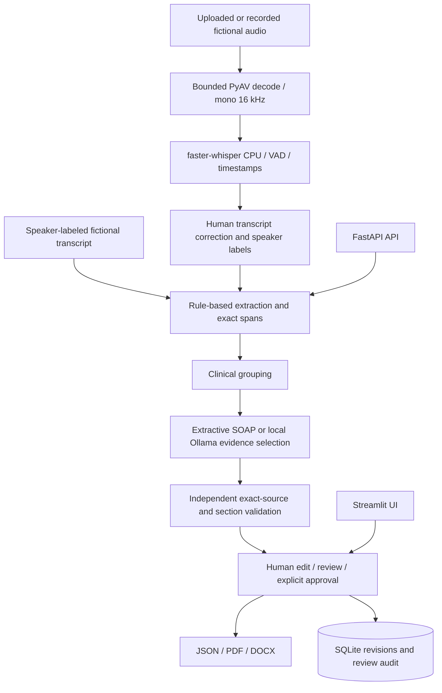
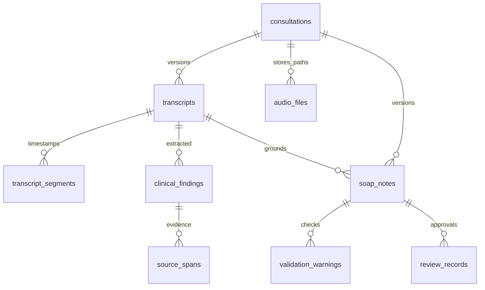

# Architecture

`backend/pipeline.py` orchestrates replaceable extraction, structuring, generation and validation modules. The Streamlit frontend and FastAPI endpoints share the same service/persistence implementation; Streamlit runs standalone without requiring an HTTP backend process. This reduces student-project deployment complexity. The API is independently usable and tested.

## Trust boundaries

- Only fictional text/audio; explicit confirmation required at input. This is an attestation, not a PHI detector.
- No external LLM API. Optional Ollama adapter uses only loopback and selects existing utterance IDs; it cannot introduce free-form clinical prose. Schema validation, full coverage and section checks enforce the contract. Failures use the extractive baseline with a visible warning.
- Source text is escaped before HTML highlighting and PDF markup. Audio names are random, size capped at 25 MB and decoded duration capped at 10 minutes.
- No speaker diarization. Unlabeled speech is `Unknown`; objective/assessment/plan assignment requires Doctor labels. No automatic clinical approval.
- Strict quote validation detects modified text, dose, duration, polarity and attribution as unsupported. It is intentionally conservative and cannot verify whether the original transcript or extraction is medically correct.
- Notes are immutable versions; editing revokes approval by creating a new unapproved version. Optimistic version checks prevent stale edits and approvals. Error-level warnings block approval; other warnings require acknowledgment.
- Database uses foreign keys, transactions and indexed consultation history. No authentication/encryption; run locally only. Not suitable for hosting real patient data.

## Database schema

Executable schema: `backend/database.py:SCHEMA`. `dataset_records` is a standalone table reserved for dataset metadata; evaluation uses versioned JSONL files. Transcript revisions retain the original text and corrected text. Notes store validated analysis snapshots and JSON section content; normalized finding/span/warning rows enable audit. Audio remains on disk, never embedded in SQLite. Deleting a session removes database records; local audio retention is manual and documented (not a production retention policy).

## Known NLP boundaries

English dictionary/rule baseline; sentence and clause scope are approximate. Family members are recognized only by listed relationship terms; doctor questions are excluded. No coreference or general medical ontology. Historical and current polarity differences are flagged conservatively. Corrections remain explicit source statements with warnings, not silently resolved. Duration attachment may be broad within a clause. Allergy/history/vital groups preserve exact source sentences rather than invent normalized values.
